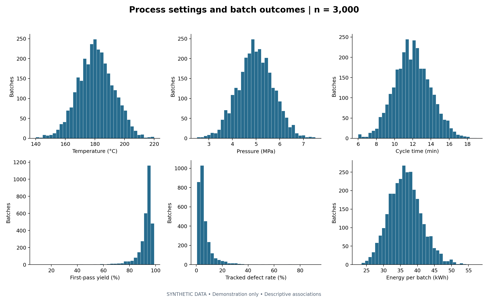
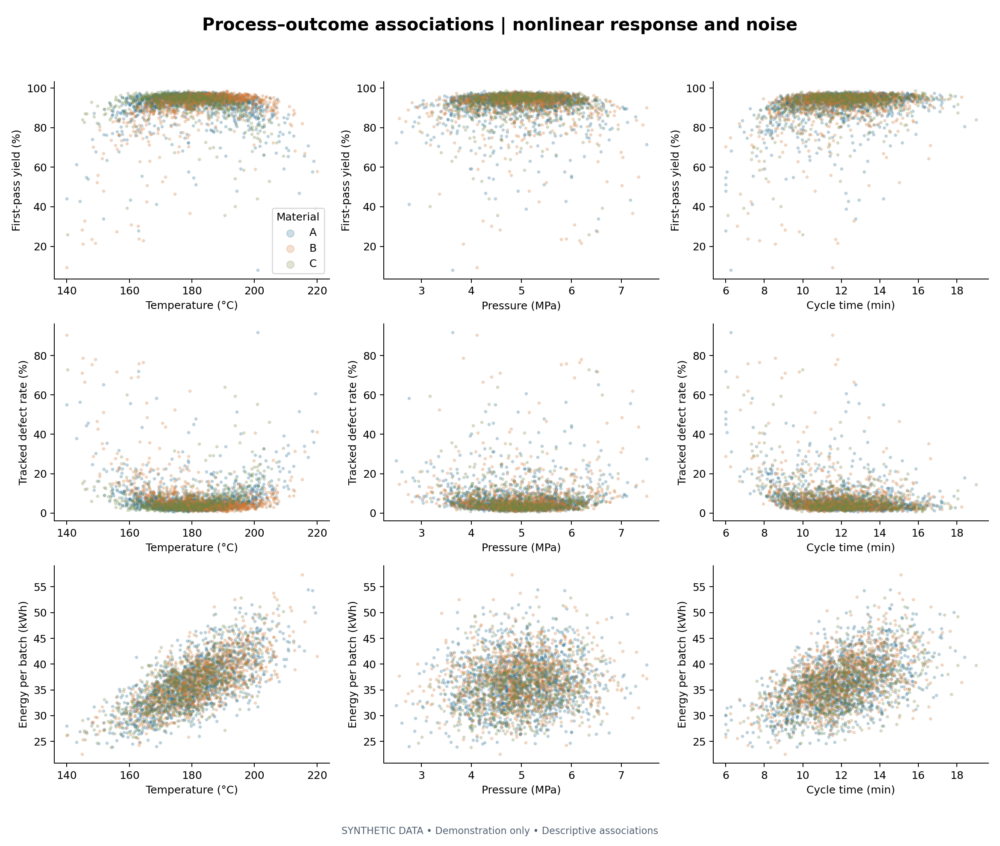

# Manufacturing Process Analytics & Optimization

**Phase 1 — exploratory engineering analysis | Synthetic demonstration data**

A reproducible Python portfolio project exploring how manufacturing settings relate to first-pass yield, tracked defects, and batch energy. It demonstrates data validation, engineering interpretation, and clear visualization. **All data are synthetic, generated for demonstration; no employer or confidential research data are used.** Optimization is a planned future phase, not an implemented capability.

## Engineering problem

Manufacturing teams need to understand variation before choosing process changes. This project examines a generic heated, pressurized batch process using temperature, pressure, cycle time, three materials, and three machines. The analysis describes associations and potential regions for further study; it does not establish causality or prescribe production settings.

## Quick start

Use Python 3.12. From the repository root:

```bash
python -m venv .venv
# Windows PowerShell: .venv\Scripts\Activate.ps1
# macOS / Linux: source .venv/bin/activate
python -m pip install -r requirements.txt
python -m src.run_pipeline
python -m unittest discover -s tests -v
python -m src.execute_notebook
```

The pipeline recreates data, tables, figures, and the findings section below. The last command executes and saves the notebook using the current Python environment. Open the saved notebook in VS Code or another Jupyter-compatible viewer. A notebook editor is not required to run the project.

## Verified Phase 1 findings

<!-- BEGIN GENERATED FINDINGS -->
Across **3,000 synthetic batches**, mean first-pass yield was **91.60%**, tracked defect rate **7.08%**, and energy **36.42 kWh/batch**.

- Cycles below 9 min (194 batches) had mean defect rate **19.86%**, versus **6.20%** for other batches.
- A predefined candidate screen (174–186 °C, 4.5–5.5 MPa, 11.5–15 min) included **330 batches** with mean defect rate **3.03%** and yield **95.56%**. Outside the screen, mean defect rate was **7.58%**. This is an exploratory comparison, not a validated operating window.
- Candidate-screen energy averaged **37.58 kWh/batch**, versus **36.27 kWh/batch** outside it; the quality association comes with higher average energy.
- Machine mean defect rates: M1: **6.25%**; M2: **6.91%**; M3: **8.18%**.
- Material mean defect rates: A: **6.87%**; B: **7.45%**; C: **6.93%**.
- Temperature–defect Pearson correlation was **-0.089**. The scatterplots show why a single linear correlation cannot describe the simulated nonlinear response.

These are unadjusted associations in synthetic data. Group composition and process settings can influence comparisons. Yield and tracked defects share a unit balance, so their strong inverse correlation is partly definitional.
<!-- END GENERATED FINDINGS -->




## Dataset and assumptions

The dataset contains 3,000 synthetic batches generated with NumPy seed **42**. Each batch represents 1,000 input units. Timestamps start on January 1, 2025 and advance by 30 minutes; they are illustrative event ordering, with no shift effects, seasonality, downtime, or drift. Materials A/B/C are anonymized fictional categories, not commercial grades.

| Field | Definition / generation bounds |
|---|---|
| batch_id | Unique batch identifier |
| timestamp | Synthetic, timezone-naive event timestamp |
| material_type / machine_id | A/B/C and M1/M2/M3 |
| temperature_C | 140–220 °C |
| pressure_MPa | 2.5–7.5 MPa |
| cycle_time_min | 6–19 min |
| yield_percent | First-pass conforming units / input units × 100 |
| defect_rate_percent | Units with at least one tracked defect / input units × 100 |
| other_loss_percent | Disjoint startup/handling losses / input units × 100 |
| energy_kWh | Positive energy consumed per equal-size batch |
| data_origin | Always `synthetic_demonstration` |

Yield, tracked defects, and other losses sum to 100%. There is no rework or double counting. Rates use 0.1 percentage-point increments. Energy validation uses an illustrative 200 kWh upper bound, not an equipment rating.

The transparent generator uses squared deviations from material-specific reference temperatures (A: 180 °C, B: 187 °C, C: 174 °C), pressure deviation, a short-cycle penalty, and a temperature–pressure interaction. A logistic transform bounds defect probability; binomial draws turn probabilities into unit counts. Machine offsets and unobserved batch noise prevent deterministic responses. Energy increases with thermal demand, cycle time, and pressure, with machine factors and multiplicative noise. Parameters are illustrative assumptions, not a calibrated physical model. Clipping process settings imposes hard bounds and can introduce boundary pileups.

## Workflow and key analyses

1. Generate synthetic batches using a fixed seed.
2. Reload the saved CSV and validate schema, types, missing data, duplicates, bounds, timestamps, and unit balance. Failed checks raise an error.
3. Export summary statistics, machine/material comparisons (count, mean, standard deviation), Pearson correlations, and predefined operating-region comparisons.
4. Save four labeled Matplotlib figures: distributions, group boxplots, process–outcome scatterplots, and a correlation matrix.
5. Regenerate this README's numerical findings directly from the analysis results.

`data/processed/region_comparisons.csv` includes a candidate screen, cycles below 9 minutes, and temperature tails below 160 or above 200 °C, each compared with its complement. Screens are chosen for illustration before inspecting results. No search for an optimum or significance test is performed.

## Repository structure

```text
engineering-process-analytics/
├── README.md
├── requirements.txt
├── .gitignore
├── data/
│   ├── raw/synthetic_batches.csv
│   └── processed/  # validation, findings, summary and comparison tables
├── src/
│   ├── __init__.py
│   ├── generate_data.py
│   ├── data_quality.py
│   ├── analysis.py
│   ├── visualization.py
│   ├── run_pipeline.py
│   └── execute_notebook.py
├── notebooks/01_exploratory_analysis.ipynb
├── figures/  # four generated PNGs
└── tests/test_pipeline.py
```

## Tools and learning path

Python, NumPy, pandas, Matplotlib, and standard-library unittest. nbformat, nbclient, and ipykernel support reproducible notebook execution. No seaborn or machine learning libraries are used.

Start with `generate_data.py` to understand the assumptions, then `data_quality.py` to learn validation. Read `analysis.py` for pandas group summaries and `visualization.py` for plotting. The notebook walks through these same functions so analysis logic stays in one place.

## Limitations and portfolio review

- Synthetic associations reflect generator choices and cannot demonstrate real manufacturing improvements or generalize to a plant.
- Group comparisons are unadjusted, unequal in size, and lack uncertainty intervals. Machine/material ranking is exploratory.
- The candidate screen pools materials with different response centers. Its apparent advantage requires controlled experiments and economic assessment before any real application.
- Energy is per batch, not measured plant energy or a validated cost/carbon model. Equal batch size simplifies comparison.
- Review process bounds, energy assumptions, and terminology with a domain specialist before presenting the project for a specific industry. Be ready to explain the response equations, unit balance, noise, and why correlation does not imply causality.
- No license is selected; the owner should choose reuse terms before publishing.

## Planned future phases — not implemented

After explicit review and approval: regression/statistical modeling; DOE / ANOVA; SPC and process capability; constrained process optimization; SQL; and a Power BI dashboard. Phase 1 contains none of these advanced capabilities.
